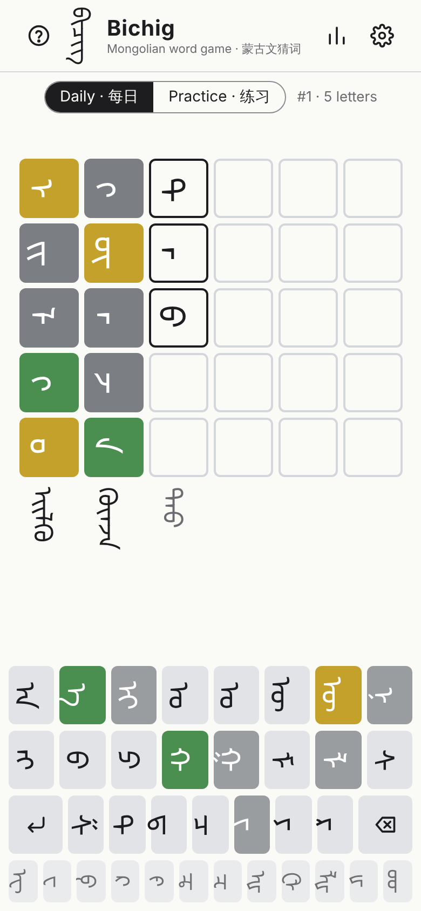
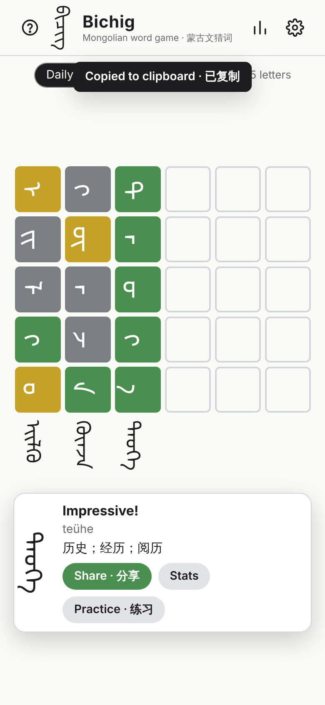
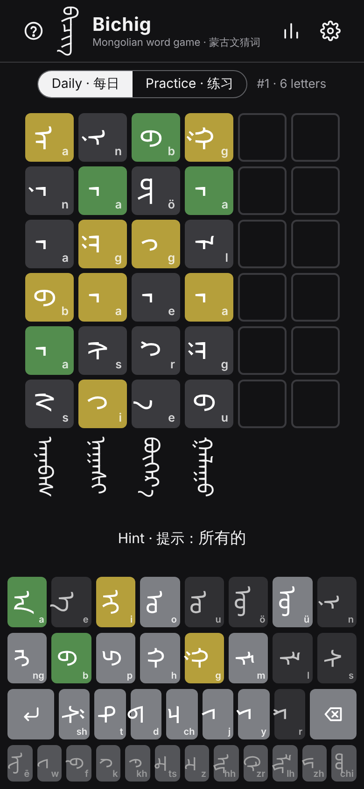
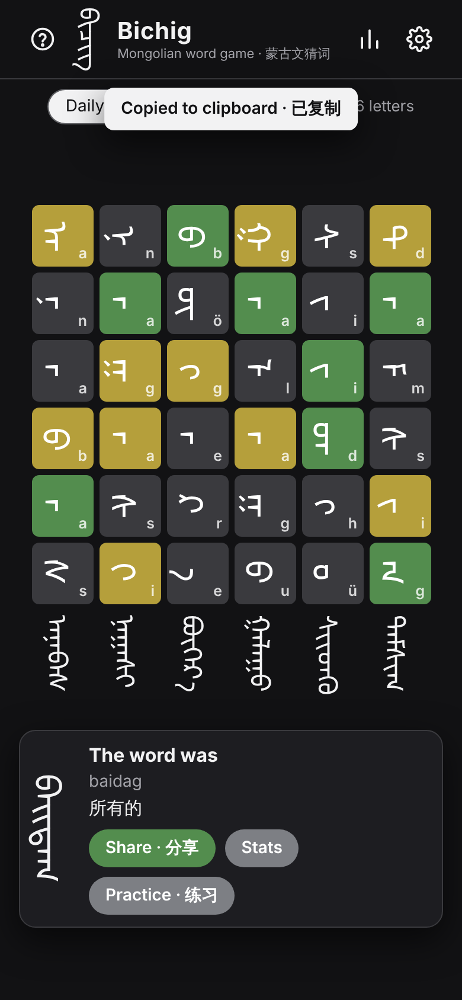

# Bichig · ᠪᠢᠴᠢᠭ

A daily word-guessing game in traditional Mongolian (Hudum) script. Guess the hidden
word in 6 tries; after each guess every tile turns green, yellow or grey. The board is
laid out the traditional way: **each guess is a column read top to bottom, columns run
left to right**, and every guess is also shown as a joined, properly shaped word.

Free and non-commercial. No backend, no tracking, no third-party requests: a static
page plus word lists, playable offline after the first visit.

| Playing (phone) | Won | Hint, Latin labels, dark | Lost |
|---|---|---|---|
|  |  |  |  |

More: [desktop](docs/screenshots/desktop.png), [help](docs/screenshots/phone-help.png),
[stats](docs/screenshots/phone-daily-stats.png).

## Play

Serve the repository root with any static file server and open it in a browser:

```sh
python3 -m http.server 8080      # or: npm run serve
# open http://localhost:8080/
```

It also works as-is on GitHub Pages (Settings → Pages → deploy from branch, root folder).
Opening `index.html` straight from disk (`file://`) does not work because browsers block
`fetch()` of the word lists there.

## How to play

- Type a word with the on-screen keyboard and press ↵. Each guess fills one column.
- **Green**: right letter in the right position. **Yellow**: the letter is in the word
  but elsewhere; it is marked yellow only as many times as it actually occurs in the
  answer (exact matches are counted first). **Grey**: not in the word.
- **Latin labels** (settings) show a transliteration on every tile and key. Use them for
  letters that share a shape in some positions (o/u, ö/ü, t/d, a/e).
- **Hint**: after your 4th guess you can reveal the Chinese meaning of the answer.
- **Daily** gives one word per day (changes at local midnight; the same for everyone).
  **Practice** gives unlimited random words and does not affect statistics.
- **Word length** 4, 5 or 6 (settings); each length has its own daily word and stats.
- If a guess is not in the word list but a listed word differs only in look-alike
  letters, the game suggests it ("did you mean …?").
- Dimmed keys are loanword letters (ē, w, f, k, kh, ts, z, …): valid in guesses, never
  in answers.
- Share copies a spoiler-free grid of coloured squares. The grid mirrors the board:
  each column of squares is a guess, each line a letter position.

```
Bichig ᠪᠢᠴᠢᠭ #1 · 5 · 3/6
🟨⬜🟩
⬜🟨🟩
⬜⬜🟩
🟩⬜🟩
🟨🟩🟩
```

Physical keyboards work too: type Mongolian directly, or Latin keys
`a e i o u n b p h g m l s t d j y r`, `c` = ch, Shift+O = ö, Shift+U = ü,
Shift+N = ng, Shift+S = sh.

## How the word list is built

Everything is produced by one reproducible script:

```sh
pip install -r scripts/requirements.txt
python scripts/build_wordlist.py     # downloads the pinned sources into .cache/
```

It writes `data/words-{4,5,6}.json` (game data), `review/answers_for_review.csv`
(word, Latin transliteration, Chinese meaning, frequency, for native-speaker review) and
[`review/wordlist_report.md`](review/wordlist_report.md) (counts per length, and how many
words were dropped and why). Sources are pinned to commits and the Lotus zip is
checked by SHA-256, so a rebuild gives byte-identical output.

Steps:

1. **Dictionary.** The Lotus `data.zip` is read in memory with its published password;
   only `mn_zh_dict.jsonl` and `zh_mn_dict.jsonl` are used for words and meanings
   (15,014 Mongolian entries). The Lotus train/test sentence files are never extracted
   or committed; the Chinese side of the training sentences is only counted in memory
   to rank glosses (step 6).
2. **Valid single words.** An entry is a game word only if it consists of nominal
   letters (U+1820–U+1842), with optional FVS after a letter and MVS only in the
   standard position before a final a/e. Entries with spaces, NNBSP or MVS suffix
   parts, ZWJ/ZWNJ (suffix fragments such as ZWJ + ᠤᠤ), Latin, Chinese, digits,
   private-use characters or Todo/Sibe/Manchu letters are rejected.
3. **Frequencies.** All text fields of all `TM-Bench/Data/*.json` files are tokenized;
   U+180E used as a suffix separator is rewritten to U+202F, the stem before the first
   suffix is taken, and stems are counted under their **mongol-norm** shape key
   (`MongolianShaper().normalize`). Dictionary words get the count of their own key.
4. **Answers** (per length): drop loanword letters, **glyph collisions** (another
   dictionary word with the same mongol-norm key, i.e. rendering identically, e.g.
   ᠣᠯᠠᠨ/ᠤᠯᠠᠨ olan/ulan, ᠬᠣᠲᠠ/ᠬᠤᠳᠠ hota/huda, ᠡᠨᠳᠡ/ᠠᠳᠠ ende/ada), the same letters
   spelled with different FVS/MVS, spellings the font cannot draw, and words seen fewer
   than 2 times in TM-Bench; rank the rest by frequency and keep up to 1,500.
5. **Allowed guesses**: every valid dictionary word of that length (one spelling per
   letter sequence).
6. **Meanings**: up to three Lotus glosses, most common first (ranked by how often each
   gloss occurs as a word in Chinese text: the Chinese side of the Lotus training
   sentences and TM-Bench CMMT, segmented by forward maximum matching).
7. **Tile forms**: for each letter of each allowed word, the FVS that makes its tile
   draw the same glyph as in the shaped word (see below).
8. **Daily order**: answers in frequency tiers of 200 (most common first), shuffled
   within each tier with a fixed seed. Day *n* after the launch date (2026-10-12)
   uses entry *n* of the list, so nothing repeats until the list wraps.

Result (details in the [report](review/wordlist_report.md)):

| length | dictionary words | allowed guesses | answers | frequency range |
|---|---|---|---|---|
| 4 | 906 | 900 | 388 | 2–8,810 |
| 5 | 1,895 | 1,892 | 748 | 2–5,242 |
| 6 | 2,235 | 2,235 | 917 | 2–3,183 |

The answer lists are shorter than the ~1,500 aimed for because Lotus simply has fewer
words of these lengths: of the 1,895 five-letter entries, 814 never occur in TM-Bench,
139 occur only once and 120 collide with a look-alike word. 748 daily words still last
about two years before the list repeats.

## Encoding decisions

- **Letter = nominal letter U+1820–U+1842.** FVS (U+180B–U+180D, U+180F), MVS (U+180E),
  NNBSP (U+202F) and ZWJ are not letters: they are kept in the stored spelling (so words
  render correctly) but ignored for counting letters and for colour feedback.
- **U+180E vs U+202F.** TM-Bench writes U+180E before every suffix
  (all 215,165 suffixed tokens); standard text and Lotus use U+202F there and U+180E only
  before a final a/e. An MVS followed by a or e (plus optional FVS) and then the end of
  the word is kept; any other MVS is treated as a suffix separator. mongol-norm gives
  the same key for both encodings (ᠤᠯᠤᠰ + U+180E + ᠤᠨ and ᠤᠯᠤᠰ + U+202F + ᠤᠨ), which the unit
  tests check.
- **Words that look identical** have the same mongol-norm key. Their frequencies cannot
  be told apart and a player could not tell them apart either, so they are never
  answers. They stay valid guesses.
- **Positional tile forms.** A tile shows the letter with ZWJ on each joining side:
  `c+ZWJ` (initial), `ZWJ+c+ZWJ` (medial), `ZWJ+c` (final), `c` (isolated); a final
  a/e after MVS is drawn as `MVS+a`. Inside a word the font also applies contextual
  rules (masculine/feminine g and h, dotted n before vowels, ö/ü after the first
  syllable, ligatures such as ᠪᠣ). The build shapes every allowed word with HarfBuzz
  and the exact font file the game ships, and for each letter picks the FVS (none or
  1–4) whose stand-alone tile draws the same glyph as inside the word, comparing glyph
  outlines. This reproduces 26,270 of 26,470 letters exactly; the rest (mostly a letter
  just before an MVS) use the plain positional form. Ligature components are recovered
  from the font's GSUB tables.
  Rendering the whole word in each tile with the other letters hidden was tried first,
  but Chromium does not apply contextual shaping across `<span>` boundaries, so it
  showed wrong forms.
- **Placeholders.** Noto Sans Mongolian draws an FVS it does not support in a position,
  or a stray MVS, as a dotted box. Tile strings are checked for such glyphs (a test
  covers every tile in the data), and the 7 Lotus spellings with such an FVS (loanwords
  like ᠺᠠᠷᠲ (kart) with FVS1 on a final t) are shown without it and never used as answers.
- **Font.** Noto Sans Mongolian v3.002 (the version Google Fonts serves) is self-hosted
  as one complete WOFF2. Google Fonts' CSS API splits the font into `unicode-range`
  slices, which breaks Mongolian shaping across slices, and would send every visitor's
  IP to a third party.
- **Vertical text** uses `writing-mode: vertical-lr`. Browsers shape Mongolian
  horizontally and rotate it, so the build shapes left-to-right like they do.
- **Transliteration** (Latin labels, CSV): a e i o u ö ü ē n ng b p h g m l s sh t d ch
  j y r w f k kh ts z hh zr lh zh chi, one label per Unicode letter, so look-alike letters
  always get different labels. ᠬ is written h and ᠭ g, close to the common Inner
  Mongolian romanization.

### Other decisions

Where the brief left room, the simplest option was chosen:

- Words with loanword letters (ē, w, f, k, kh, ts, z, hh, zr, lh, zh, chi) are not
  answers; they are on a dimmed fifth keyboard row for guesses.
- Answers need a TM-Bench frequency of at least 2 (one occurrence in a 750k-token
  benchmark is weak evidence of a common word).
- The UI text is English with short Chinese labels; the hint is the Chinese meaning.
- The page is `index.html` (UI) plus `core.js` (pure game logic, shared with the unit
  tests), `sw.js` (offline cache), the font and the data JSON.
- Progress and statistics live only in the browser's `localStorage`.

## Tests

```sh
pip install -r scripts/requirements.txt
python -m pytest tests          # normalization, letters, word-list invariants, tile forms
npm test                        # core.js: feedback, repeated letters, daily word, sharing
npm run test:e2e                # headless Chromium; needs the `playwright` package
```

- `tests/test_mongol_text.py`: U+180E and U+202F suffix forms get the same key; stems
  match the dictionary word; look-alike words collide; letter extraction ignores
  FVS/MVS/NNBSP/ZWJ; validity rules; frequency counting.
- `tests/test_tile_forms.py`, `tests/test_wordlist_data.py`: tile strings, the dotted g
  of ᠬᠠᠭᠠᠨ, no placeholder glyph in any tile; every answer is a valid 4/5/6-letter
  allowed word, and no two answers look identical.
- `tests/core.test.mjs`: two-pass feedback with repeated letters, keyboard states,
  daily determinism (same date, same word; no repeats within the list; DST-safe local
  dates), suggestions and share text.
- `tests/e2e/play.mjs`: plays full daily (win, loss) and practice games at phone and
  desktop sizes, checks every tile colour, hint, stats, share text, offline reload, and
  measures in the browser that words are shaped and joined, that all 35 letters have
  distinct positional forms, and that every measurable tile has exactly the advance of
  its letter inside the shaped word (1,107/1,107). It writes the screenshots in
  `docs/screenshots/` and [`docs/e2e-report.md`](docs/e2e-report.md).

## Layout

```
index.html, core.js, sw.js, manifest.webmanifest, icon.svg   the game
fonts/                    Noto Sans Mongolian (WOFF2) + OFL licence
data/words-N.json         answers [spelling, Chinese meaning] in daily order, allowed guesses, tile FVS codes
scripts/                  build_wordlist.py, mongol_text.py, tile_forms.py
review/                   answers_for_review.csv, wordlist_report.md
tests/                    Python, Node and end-to-end tests
docs/                     screenshots and e2e report
```

## Credits and licences

- **Lotus** dictionary, from *Can Large Language Models Translate Unseen Languages in
  Underrepresented Scripts?* (EMNLP 2025), <https://github.com/csdq777/Lotus>.
  Data licensed **CC BY-NC 4.0**. The word lists in `data/` and `review/` are derived
  from it and are therefore also CC BY-NC 4.0 (attribution, non-commercial).
- **TM-Bench** (SIGIR 2026), <https://github.com/gao1948083886/TM-Bench>, MIT. Used for
  word frequencies only.
  ```bibtex
  @inproceedings{gao2026tmbench,
    title={TM-Bench: Benchmarking Large Language Models on Low-Resource Traditional Mongolian},
    author={Zhenjie Gao and Feilong Bao and Aruukhan and Ruichen Hou and Jixieqi and Dabalgan Wang and Hugejile and Yuan Li},
    booktitle={Proceedings of the 49th International ACM SIGIR Conference on Research and Development in Information Retrieval},
    year={2026}
  }
  ```
- **mongol-norm** (UTN #57 shaping and normalization), <https://github.com/Satsrag/mongol-norm>, MIT.
- **Noto Sans Mongolian**, © The Noto Project Authors, SIL Open Font License 1.1
  (`fonts/OFL.txt`).
- Build-time tools: HarfBuzz via uharfbuzz, fontTools.

No licence has been chosen yet for the game code itself.
